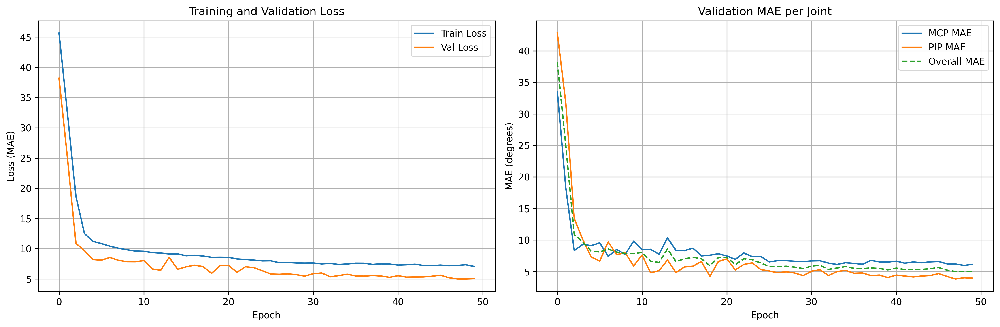

# Ultrasound-Based Finger Angle Prediction

Predicting finger joint angles (MCP, PIP) from wrist ultrasound images using CNN-TCN hybrid deep learning model.

## 🎯 Project Overview

This project demonstrates that **finger joint angles can be predicted from ultrasound images of the wrist** using deep learning. The model achieves practical accuracy suitable for real-world applications like VR/AR interfaces, gesture recognition, and rehabilitation monitoring.

## 📊 Results

| Metric | Value | Status |
|--------|-------|--------|
| **Overall MAE** | **5.62°** | ✅ Practical accuracy |
| **MCP MAE** | 5.75° | ✅ Good |
| **PIP MAE** | 5.50° | ✅ Good |

### Training History



*The model shows stable convergence with no overfitting. Loss decreases consistently from ~45° to ~5° over 50 epochs.*

## 🏗️ Model Architecture

### CNN-TCN Hybrid Model

- **CNN Backbone**: ResNet-18 (pretrained on ImageNet)
  - Extracts spatial features from each ultrasound frame
  - 512-dimensional feature vector per frame

- **TCN (Temporal Convolutional Network)**
  - Dilated causal convolutions (dilation: 1, 2, 4)
  - Captures temporal dependencies across frames
  - Channels: 512 → 256 → 128 → 64

- **Regression Head**
  - Fully connected layers
  - Output: 2 values (MCP angle, PIP angle)

### Key Features

✅ **Temporal modeling**: Uses 7 consecutive frames (~210ms window)
✅ **Transfer learning**: Pretrained ResNet-18 backbone
✅ **Dilated convolutions**: Efficient long-range temporal dependencies
✅ **MAE loss**: Directly interpretable as average angle error

## 📁 Dataset

### Overview
- **Total samples**: 3,555 synchronized ultrasound-angle pairs
- **Train/Val/Test split**: 80% / 10% / 10% (sequential, time-ordered)
- **Temporal order preserved**: No random shuffling for realistic evaluation

### Data Statistics
| Split | Samples | MCP Range | PIP Range |
|-------|---------|-----------|-----------|
| Train | 2,844 | 3.9° - 93.3° | 6.1° - 110.0° |
| Val | 355 | 6.2° - 91.5° | 7.5° - 110.0° |
| Test | 356 | 11.8° - 78.6° | 7.8° - 110.0° |

### Data Format
- **Images**: Ultrasound frames (PNG format, grayscale → RGB)
- **Angles**: CSV files with `[image_filename, MCP_Flex, PIP_Flex]`
- **Frame rate**: ~6 FPS (synchronized with 60 FPS angle measurements)

### Download Ultrasound Images
⚠️ Ultrasound images (3,555 PNG files, ~238MB) are not included in this repository due to size constraints.

**Download from GitHub Releases:**
- 📦 [251002_wrist_images.zip](https://github.com/eekimsj/ultrasound-finger-angle-prediction/releases/download/v1.0.0/251002_wrist_images.zip) (238MB)

After downloading:
```bash
unzip 251002_wrist_images.zip -d data/
```

## 🚀 Quick Start

### Option 1: Google Colab (Recommended)

[](#)

1. Open the Colab notebook: [`notebooks/Ultrasound_Angle_Prediction_Colab.ipynb`](notebooks/Ultrasound_Angle_Prediction_Colab.ipynb)
2. Enable GPU: `Runtime → Change runtime type → GPU (T4)`
3. Upload data or mount Google Drive
4. Run all cells

**Expected training time**: ~1-2 hours on GPU T4

See detailed guide: [COLAB_SETUP_GUIDE.md](docs/COLAB_SETUP_GUIDE.md)

### Option 2: Local Training

#### Prerequisites
- Python 3.8+
- CUDA-capable GPU (recommended)
- 4GB+ RAM

#### Installation

```bash
# Clone repository
git clone https://github.com/yourusername/ultrasound-finger-angle-prediction.git
cd ultrasound-finger-angle-prediction

# Install dependencies
pip install -r requirements.txt

# Download dataset (images)
# Place ultrasound images in: data/251002_wrist/
```

#### Training

```bash
python src/train.py
```

**Configuration** (in `src/train.py`):
```python
CONFIG = {
    'window_size': 7,        # Temporal window
    'batch_size': 16,        # Batch size
    'epochs': 50,            # Training epochs
    'learning_rate': 1e-4,   # Learning rate
}
```

## 📊 Performance Analysis

### Learning Curves

The model shows excellent training dynamics:
- **No overfitting**: Validation loss follows training loss closely
- **Stable convergence**: Smooth loss decrease without large fluctuations
- **Continued improvement**: Loss still decreasing at epoch 50

### Per-Joint Performance

| Joint | MAE | Interpretation |
|-------|-----|----------------|
| **PIP** | 5.50° | Better performance (easier to predict) |
| **MCP** | 5.75° | Slightly harder (more complex motion) |

### Practical Implications

**MAE = 5.6°** means:
- If actual angle is 45°, model predicts 39.4° - 50.6° on average
- Sufficient for: VR/AR control, gesture recognition, motion tracking
- May need improvement for: Medical applications, precise robotic control

## 🔬 Technical Details

### Training Configuration

```python
Model: CNN-TCN
  - Backbone: ResNet-18
  - TCN Channels: [256, 128, 64]
  - Window Size: 7 frames
  - Dropout: 0.2

Optimizer: Adam
  - Learning Rate: 1e-4
  - Weight Decay: 1e-5

Scheduler: ReduceLROnPlateau
  - Factor: 0.5
  - Patience: 5 epochs

Loss: MAE (L1 Loss)

Data Augmentation (training only):
  - Random horizontal flip (p=0.3)
  - Random rotation (±5°)
  - Color jitter (brightness/contrast ±10%)
```

### Model Parameters
- **Total parameters**: ~11.3M
- **Trainable parameters**: ~11.3M

## 📂 Project Structure

```
ultrasound-finger-angle-prediction/
├── README.md                          # This file
├── requirements.txt                   # Python dependencies
├── .gitignore                         # Git ignore rules
│
├── notebooks/
│   └── Ultrasound_Angle_Prediction_Colab.ipynb  # Colab training notebook
│
├── src/
│   ├── model.py                       # CNN-TCN model architecture
│   ├── dataset.py                     # Dataset and DataLoader
│   └── train.py                       # Training script
│
├── data/
│   ├── train.csv                      # Training data (2,844 samples)
│   ├── val.csv                        # Validation data (355 samples)
│   ├── test.csv                       # Test data (356 samples)
│   └── 251002_wrist/                  # Ultrasound images (download separately)
│       └── ultrasound_frame_*.png
│
├── results/
│   ├── best_model.pth                 # Trained model (download from GitHub Releases)
│   ├── training_history.png           # Training curves
│   ├── test_results.json              # Test set results
│   └── README.md                      # Model download instructions
│
└── docs/
    └── COLAB_SETUP_GUIDE.md           # Detailed Colab setup guide
```

## 🎯 Use Cases

### ✅ Ready for Production
- **VR/AR hand tracking**: Real-time finger angle estimation
- **Gesture recognition**: Classify hand gestures based on angles
- **Human-computer interaction**: Novel input modality
- **Research**: Ultrasound-based motion capture

### 🟡 Needs Improvement
- **Medical rehabilitation**: Requires higher precision (<3°)
- **Robotic control**: May need additional sensors for safety

## 🔮 Future Work

### Potential Improvements
1. **More data**: Collect from multiple subjects
2. **Data augmentation**: Temporal augmentation (frame dropping, speed variation)
3. **Architecture**: Try EfficientNet, Vision Transformer
4. **Multi-task learning**: Predict all 5 fingers simultaneously
5. **Real-time inference**: Model optimization, quantization

### Expected Performance Gains
With improvements above, MAE could potentially reach **3-4°**.

## 📄 Citation

If you use this work in your research, please cite:

```bibtex
@misc{ultrasound-finger-2025,
  author = {Your Name},
  title = {Ultrasound-Based Finger Angle Prediction using CNN-TCN},
  year = {2025},
  publisher = {GitHub},
  url = {https://github.com/yourusername/ultrasound-finger-angle-prediction}
}
```

## 📜 License

MIT License - see [LICENSE](LICENSE) file for details

## 🙏 Acknowledgments

- PyTorch team for the deep learning framework
- ResNet-18 pretrained weights from torchvision
- TCN architecture inspired by [Bai et al. 2018](https://arxiv.org/abs/1803.01271)

## 📧 Contact

For questions or collaboration:
- GitHub Issues: [Create an issue](#)
- Email: your-email@example.com

---

**⭐ If you find this project useful, please consider giving it a star!**
